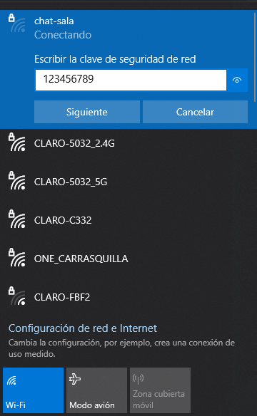
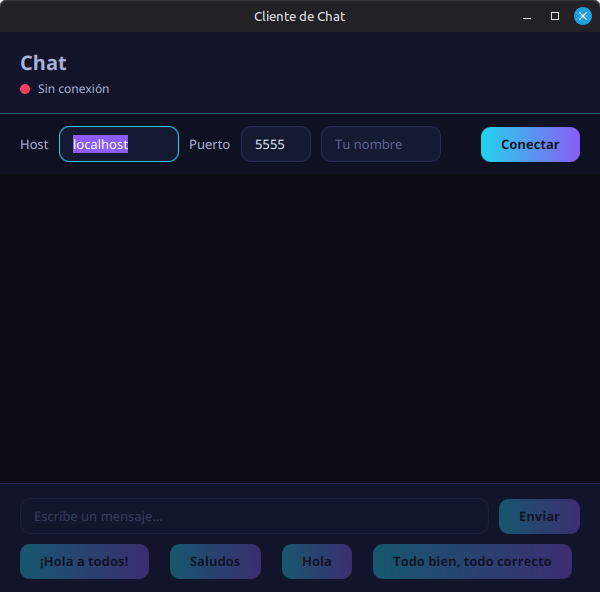

# CHAT SIMPLE - JAVA

Antes de ejecutar el programa, es necesario estar conectado en la misma sala del chat.



Una vez conectado a la sala de chat, se puede ejecutar el cliente.

Para ejecutar el cliente del chat se debe ir a la carpeta del pom.xml y ejecutar:

```java
mvn javafx:run
```

Despues de ejecutar la app, pedira el puerto del chat y la direccion ip, una vez conectado, listo. Ya se podra chatear.

